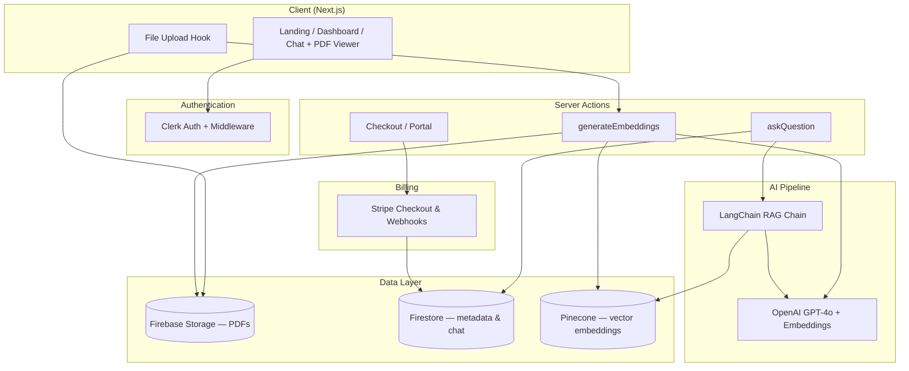

# Chat with PDF

> A production-style SaaS app that turns PDF documents into interactive, context-aware AI conversations — built to demonstrate full-stack engineering, RAG architecture, and monetization patterns.

[](https://nextjs.org/)
[](https://www.typescriptlang.org/)
[](https://js.langchain.com/)
[](https://openai.com/)
[](https://firebase.google.com/)
[](https://www.pinecone.io/)
[](https://clerk.com/)
[](https://stripe.com/)

**Repository:** [github.com/ProgramingWithDave/chat-with-pdf-old](https://github.com/ProgramingWithDave/chat-with-pdf-old)

---

## Overview

**Chat with PDF** is an AI-powered document companion. Users upload PDFs, ask natural-language questions, and receive answers grounded in the document content — with chat history, an inline PDF viewer, and a freemium subscription model.

This project showcases the kind of end-to-end product work I deliver: from UX and frontend polish to backend pipelines, vector search, auth, payments, and deployment-ready architecture.


---

## What This Project Demonstrates

| Area | Skills & decisions |
|------|-------------------|
| **AI / RAG** | PDF ingestion, text splitting, OpenAI embeddings, Pinecone vector store, history-aware retrieval chains (LangChain) |
| **Full-stack** | Next.js 14 App Router, Server Actions, protected routes, optimistic UI, real-time Firestore listeners |
| **Auth & security** | Clerk middleware, server-side route protection, user-scoped data in Firebase |
| **SaaS / payments** | Stripe Checkout, Customer Portal, webhook-driven subscription state |
| **Cloud infra** | Firebase Storage + Firestore, Pinecone namespaces per document, Vercel deployment |
| **Frontend** | React 18, Tailwind CSS, shadcn/ui, react-pdf viewer, drag-and-drop uploads |

---

## Features

- **PDF upload & cloud storage** — Drag-and-drop uploads to Firebase Storage with progress tracking
- **Semantic search (RAG)** — Documents are chunked, embedded, and stored in Pinecone for retrieval-augmented generation
- **Context-aware chat** — History-aware retriever rewrites queries using prior conversation for better answers
- **Split-pane workspace** — Chat alongside an interactive PDF viewer (zoom, rotate, pagination)
- **Real-time chat sync** — Messages persist in Firestore and update live via `react-firebase-hooks`
- **Freemium limits** — Free tier (2 docs, 2 questions/doc) vs Pro tier (20 docs, 20 questions/doc)
- **Stripe subscriptions** — Checkout, billing portal, and webhook handlers for membership lifecycle
- **Responsive design** — Works across desktop, tablet, and mobile

---

## Architecture



**RAG flow (simplified):**

1. User uploads a PDF → stored in Firebase Storage, metadata saved to Firestore
2. Server Action downloads the PDF, splits text, generates embeddings via OpenAI
3. Embeddings are stored in Pinecone (one namespace per document)
4. On each question, a history-aware retriever fetches relevant chunks and GPT-4o generates a grounded answer
5. Chat messages are persisted per user, per document

---

## Tech Stack

| Layer | Technologies |
|-------|-------------|
| **Framework** | Next.js 14, React 18, TypeScript |
| **Styling** | Tailwind CSS, shadcn/ui, DaisyUI |
| **Auth** | Clerk |
| **Database** | Firebase Firestore |
| **File storage** | Firebase Storage |
| **Vector DB** | Pinecone |
| **AI** | LangChain, OpenAI (GPT-4o, text-embedding) |
| **Payments** | Stripe (Checkout, Portal, Webhooks) |
| **PDF** | react-pdf, pdf-parse, LangChain PDFLoader |
| **Deployment** | Vercel |

---

## Project Structure

```
chat-with-pdf-old/
├── app/
│   ├── page.tsx                 # Marketing landing page
│   ├── dashboard/               # Protected app routes
│   │   ├── page.tsx             # Document list
│   │   ├── upload/              # PDF upload
│   │   ├── files/[id]/          # Chat + PDF viewer
│   │   └── upgrade/             # Pricing & Stripe
│   └── webhook/route.ts         # Stripe webhook handler
├── actions/                     # Next.js Server Actions
│   ├── askQuestion.ts
│   ├── generateEmbeddings.ts
│   ├── createCheckoutSession.ts
│   └── deleteDocument.ts
├── components/                  # UI components
├── lib/
│   ├── langchain.ts             # RAG pipeline
│   ├── pinecone.ts
│   └── hooks/                   # useUpload, useSubscription
├── firebase/                    # Client & Admin SDK setup
└── middleware.ts                # Clerk route protection
```

---

## Getting Started

### Prerequisites

- Node.js 18+
- Accounts for: [Clerk](https://clerk.com), [Firebase](https://firebase.google.com), [Pinecone](https://www.pinecone.io), [OpenAI](https://platform.openai.com), [Stripe](https://stripe.com)

### 1. Clone & install

```bash
git clone https://github.com/ProgramingWithDave/chat-with-pdf-old.git
cd chat-with-pdf-old
npm install
```

### 2. Environment variables

Create a `.env.local` file in the project root:

```env
# OpenAI
OPENAI_API_KEY=

# Pinecone
PINECONE_API_KEY=

# Clerk
NEXT_PUBLIC_CLERK_PUBLISHABLE_KEY=
CLERK_SECRET_KEY=

# Firebase (client)
FIREBASE_API_KEY=

# Stripe
STRIPE_API_KEY=
STRIPE_WEBHOOK_SECRET=
NEXT_PUBLIC_STRIPE_PUBLISHABLE_KEY=
```

### 3. Firebase Admin

Place your Firebase service account JSON at `service_key.json` in the project root (used by `firebase/firebaseAdmin.ts`). This file is gitignored — never commit credentials.

Configure [CORS on Firebase Storage](https://firebase.google.com/docs/storage/web/download-files#cors_configuration) so PDFs can be fetched client-side for the viewer.

### 4. Pinecone

Create an index named `daveprogrammer` (or update `indexName` in `lib/langchain.ts`) with dimensions matching your embedding model.

### 5. Stripe

- Create a subscription product and price
- Update the price ID in `actions/createCheckoutSession.ts`
- Point Stripe webhooks to `/webhook` for `checkout.session.completed`, `customer.subscription.deleted`, etc.

### 6. Run locally

```bash
npm run dev
```

Open [http://localhost:3000](http://localhost:3000).

For Stripe webhooks in development, use the [Stripe CLI](https://stripe.com/docs/stripe-cli):

```bash
stripe listen --forward-to localhost:3000/webhook
```

---

## Scripts

| Command | Description |
|---------|-------------|
| `npm run dev` | Start development server |
| `npm run build` | Production build |
| `npm run start` | Start production server |
| `npm run lint` | Run ESLint |

---

## Why This Matters for Teams & Investors

Building Chat with PDF required more than wiring an API to a chat box. The hard parts — and what this repo proves — are:

1. **Designing a RAG pipeline** that handles PDF parsing, chunking, embedding reuse, and conversation-aware retrieval
2. **Scoping multi-tenant data** so every user’s files, chats, and vectors stay isolated
3. **Shipping a monetizable product** with tier limits enforced server-side, not just in the UI
4. **Integrating five external services** (Clerk, Firebase, Pinecone, OpenAI, Stripe) into one cohesive UX

If you're evaluating a full-stack or AI engineer who can own features from idea to production, this project is a concrete example of that work.

---

## Author

**Dave** — [@ProgramingWithDave](https://github.com/ProgramingWithDave)

---

## License

This project is for portfolio and demonstration purposes. Contact the author for licensing or collaboration inquiries.
